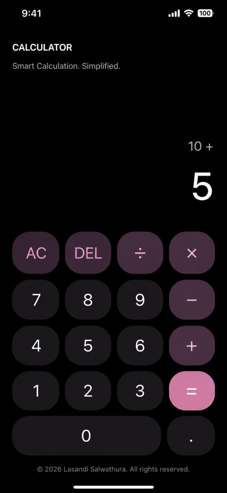

# Simple Calculator

A mobile calculator built with Expo, React Native, and TypeScript. The app
provides a clean portrait layout with number, decimal, arithmetic operator,
clear, delete, and equals controls.

## Features

- Addition, subtraction, multiplication, and division
- Decimal number input
- Clear (`AC`) and delete (`DEL`) actions
- Division-by-zero and invalid-result error handling
- Responsive display sizing for long values
- Press feedback for calculator buttons
- Expo Router entry point with Android, iOS, and web support

## Tech stack

- Expo SDK 58
- React Native 0.88
- React 19
- TypeScript
- Expo Router

## Project structure

```text
src/
  app/index.tsx                  Calculator screen
  components/CalculatorButton.tsx Reusable calculator button
  hooks/useCalculator.ts          Calculator state and interaction logic
  styles/calculator.styles.ts     Mobile calculator styling
  utils/calculator.ts             Arithmetic and error handling
assets/
  evidence/calculator-result.jpg  App evidence screenshot
```

## Getting started

### Prerequisites

- Node.js
- npm
- Expo Go, an Android emulator, an iOS simulator, or a web browser

### Install dependencies

```bash
npm install
```

### Start the development server

```bash
npx expo start
```

From the Expo CLI, scan the QR code with Expo Go or select a simulator/web
target.

## Available commands

```bash
npm run start    # Start Expo
npm run android  # Start on Android
npm run ios      # Start on iOS
npm run web      # Start in a browser
npm run lint     # Run Expo ESLint checks
npx tsc --noEmit # Type-check the project
```

## Evidence

The following screenshot was supplied as evidence of the calculator interface
and is stored in the repository at
[`assets/evidence/calculator-result.jpg`](./assets/evidence/calculator-result.jpg).



## License

This project is distributed under the license in [`LICENSE`](./LICENSE).
